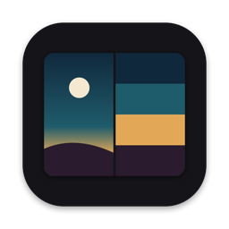
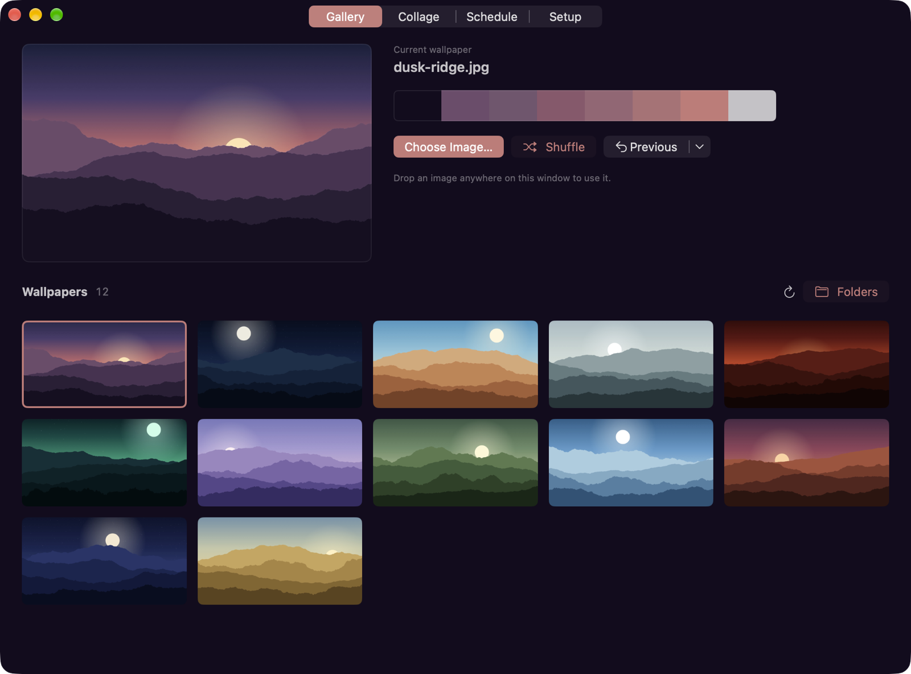
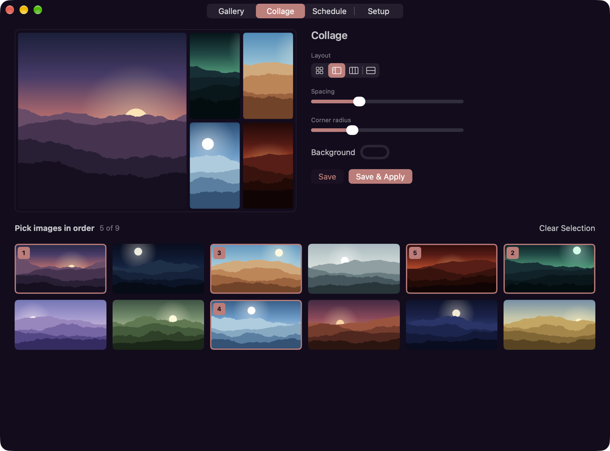
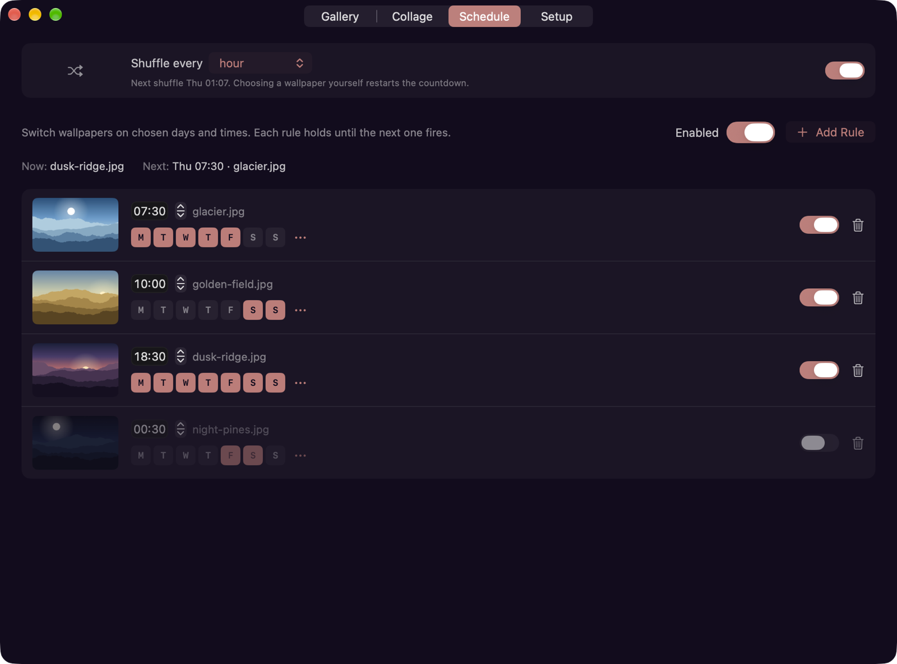
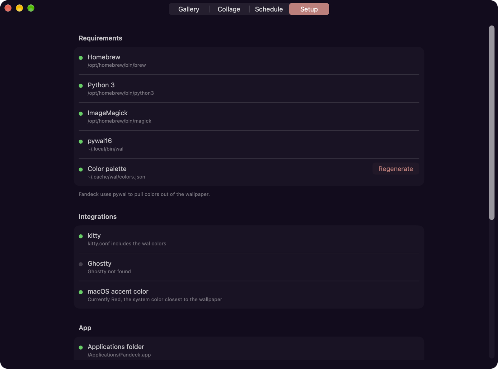

<p align="center"></p>

<h1 align="center">Fandeck</h1>

<p align="center">A macOS app that sets your wallpaper and matches the kitty terminal and the system accent color to it.</p>

Fandeck uses [pywal16](https://github.com/eylles/pywal16) to pull a palette out of the wallpaper. When you pick an image, Fandeck sets it on every Space, generates a 16 color palette, reloads kitty with that palette and sets the macOS accent and text highlight colors to match. The app window takes on the same colors.

The name comes from the fan decks painters use to pick paint colors.



## Features

- Gallery: shows every image in your wallpaper folders. Click one to apply it, or drop an image file onto the window. Previous goes back one wallpaper, and its arrow lists the last ten.
- Wallpaper folders: choose which folders Fandeck reads from. It starts with `~/Pictures/Wallpapers`. Subfolders are included, and images you add or delete in Finder show up right away. An image applied from anywhere else is copied into the primary folder, the first one in the list, so it stays available.
- Collage: combine up to 9 images in a grid, feature, column or row layout. You can adjust the spacing, corner radius and background color. Collages are saved at your screen's full resolution.
- Schedule: change the wallpaper by day and time, for example a light image on weekday mornings and a dark one every evening. A rule stays in effect until the next rule fires. If the Mac was asleep when a rule was due, it runs on wake.
- Timed shuffle: pick a random image every 15 minutes, every hour or up to once a day. It skips the images shown recently, and choosing a wallpaper yourself restarts the countdown.
- System Settings sync: if you change the wallpaper in System Settings, Fandeck updates the colors to match.
- Menu bar: shuffle, go back to the previous wallpaper, regenerate colors or turn the timed shuffle and the schedule on and off. Closing the window leaves Fandeck running in the menu bar.
- Setup page: checks for Homebrew, Python, ImageMagick and pywal16 and installs what is missing. It also connects kitty and controls open at login.

## Screenshots







## Requirements

- macOS 14 or later on Apple silicon
- Xcode Command Line Tools to build the app
- Homebrew, Python 3, ImageMagick and pywal16. The Setup page can install the last three for you.

## Install

```sh
git clone https://github.com/MrShiroLu/fandeck.git
cd fandeck
./build.sh
open build/Fandeck.app
```

On first launch Fandeck moves itself to `/Applications`, opens again from there and turns on open at login so the schedule and System Settings sync keep working after a restart. You can turn open at login off on the Setup page and it will stay off. Go through the rest of the Setup page once.

`./build.sh --install` builds the app and copies it straight to `/Applications`.

You can also use the script on its own, without the app:

```sh
brew install imagemagick pipx
pipx install pywal16
python3 fandeck.py --set ~/Pictures/some-wallpaper.jpg
```

Without `--set` the script only updates the colors. Without a path it uses the current wallpaper.

## kitty

The Setup page adds this line to the top of `~/.config/kitty/kitty.conf` and keeps a backup of the old file:

```conf
include ~/.cache/wal/colors-kitty.conf
```

Settings further down in your config, such as `background_opacity`, still take effect. Fandeck sends kitty a `SIGUSR1` signal so open windows reload their colors.

## How it works

| File | Role |
| --- | --- |
| `fandeck.py` | Runs `wal` on the image, picks the most vivid palette color, maps it to the nearest `AppleAccentColor`, sets a matching `AppleHighlightColor` and notifies running apps of the change. With `--set` it also sets the wallpaper on every Space. |
| `app/` | The SwiftUI app. It runs the bundled script, watches the wallpaper store to catch changes made in System Settings and watches your wallpaper folders for new images. |
| `tools/make-icon.swift` | Draws the app icon with CoreGraphics. `tools/make-icon.sh` turns the drawing into `AppIcon.icns`. |
| `tests/` | Logic tests for the schedule, shuffle and history, collage layouts, thumbnails, folder scanning and file watching. Run them with `./build.sh test`. |

`NSWorkspace.setDesktopImageURL` only changes the wallpaper of the current Space. To cover every Space, `fandeck.py --set` writes the same entry that the "Show on all Spaces" option in System Settings writes, in `~/Library/Application Support/com.apple.wallpaper/Store/Index.plist`. It then restarts `WallpaperAgent` to load the change.

## Limitations

- macOS has eight accent colors: graphite and seven hues. Fandeck picks the closest one, so the accent will not match the wallpaper exactly. Mostly gray wallpapers end up graphite.
- Other apps can't be recolored from outside. Apps that support pywal, such as VS Code or Firefox with pywalfox, can read the palette from `~/.cache/wal`.
- Applying a wallpaper from Fandeck replaces separate per-Space wallpapers with one image.
- On a MacBook with a notch the menu bar icon can end up hidden behind it. Opening Fandeck from Spotlight or the Applications folder brings the window back.
- The app is ad-hoc signed, so macOS asks for folder access again after every new build.

## Uninstall

Turn off open at login on the Setup page, quit Fandeck from the menu bar, then run:

```sh
rm -rf /Applications/Fandeck.app ~/Library/Application\ Support/Fandeck
defaults delete com.vyke.fandeck
```

To undo the kitty change, delete the two Fandeck lines at the top of `~/.config/kitty/kitty.conf` or restore `kitty.conf.fandeck-backup` from the same folder. The accent color stays as it was last set. You can pick another one in System Settings › Appearance.

## License

MIT. See [LICENSE](LICENSE).
